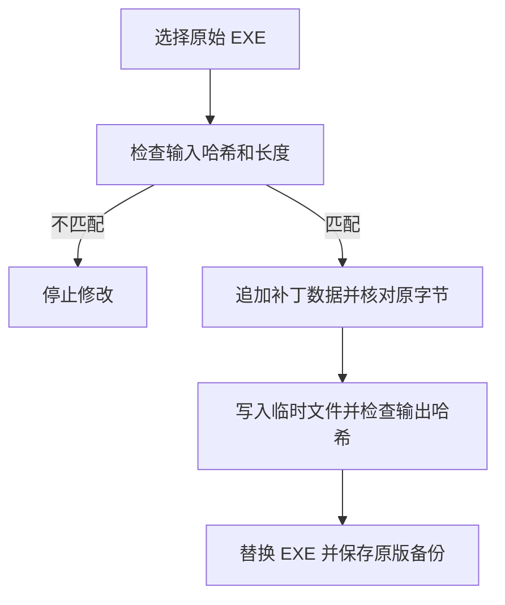

# 补丁实现原理

本文说明本项目对 PCL 2.99.0.0 两个特定构建所做的修改，以及脚本如何校验、写入和还原文件。使用步骤请见 [项目首页](../README.md)；各版本的完整教程分别在 [正式版教程](413.50.md) 和 [快照版教程](414.0.md)。

## 工作方式

PCL 的目标 EXE 是 Windows PE 格式的 .NET 程序，其中包含托管代码及其元数据。本项目是针对这两个文件的**离线二进制补丁**：脚本读取用户选择的原始 EXE，根据对应版本的清单修改指定位置，并附加预先准备的 .NET IL 方法体。

修补结果写回 EXE 后，PCL 正常启动时就会使用修改后的代码；不需要后台进程、运行时注入、注册表项目或每次启动重新打补丁。EXE 被更新或覆盖后，旧修改也会随之消失。



上图描述 `Apply` 的主要流程；`Preview` 和 `Restore` 的行为见下文。

## 三个核心文件

| 文件 | 作用 |
| --- | --- |
| `Patch.ps1` | 选择目标文件，执行预览、补丁写入及还原。两个版本目前使用相同脚本。 |
| `manifest.json` | 声明适用版本、输入和输出文件的长度与 SHA-256、载荷的 SHA-256，以及一组字节替换操作。 |
| `payload.bin` | 预先生成的二进制补丁数据，包含放入目标 EXE 的托管方法体等内容；两个版本各有一份。 |

可以直接查看 [脚本](../sources/413.50/Patch.ps1)、[正式版清单](../sources/413.50/manifest.json) 与 [快照版清单](../sources/414.0/manifest.json)。压缩包中包含与各自 `sources` 目录对应的文件。

清单里的每项 `operations` 都有文件偏移 `offset`、原文件在该位置应有的字节 `expected`，以及等长的替换字节 `replacement`。例如，以下只是正式版清单中的一项，并不是完整清单：

```json
{
  "offset": 180442,
  "expected": "72334701707efb09",
  "replacement": "7e0f040004000000"
}
```

`offset` 是从文件开头计算的**字节偏移**。脚本先将 `expected` 与原始文件逐字节比较，完全一致才会把 `replacement` 写入待生成的结果。其他位置仍会由原始 EXE 提供，新增的载荷附加在原文件末尾。

## 程序中修改了什么

以下名称和地址来自对这两个目标 EXE 的 PE 结构、.NET 元数据及项目清单的静态核对；它们不是适用于其他版本的通用补丁位置。

| 位置 | 本补丁的处理 |
| --- | --- |
| `PCL.PageDownloadInstall.LoaderInit` | 在原方法体中替换一段 IL，使下载页面初始化时读取程序已有的 `PCL.ModDownload.DlClientListLoader`，用于恢复 Minecraft 版本列表的加载路径。 |
| `PCL.ModModpack.ModpackInstall` | 两个同名重载的方法入口分别指向载荷中的方法体，涉及整合包导入与安装调用。 |
| `PCL.PageDownloadResourceDetail.InitializeStackResourceVersions` | 将资源详情页的版本列表初始化方法入口指向载荷中的方法体，涉及版本列表及安装入口。 |

脚本并非现场编译这些方法，也不会从网络下载 PCL。`payload.bin` 中的数据已经按目标构建预先制作；脚本做的是校验、拼接和替换。各方法的实际效果仍要通过对应构建的运行测试判断。

### PE 区段与方法入口

这两个原版 EXE 都有 `.reloc` 区段。补丁在该区段原有文件数据之后附加 2,048 字节，同时修改区段头，将其虚拟大小从 `0x0C` 改为 `0xA00`，文件数据大小从 `0x200` 改为 `0xA00`，并清除该区段的可丢弃标志。这样扩展后的区段可以承载附加的方法体。

接着，补丁修改 .NET `MethodDef` 元数据中的三个 RVA（相对虚拟地址），让对应方法指向附加区段中的方法体。静态核对结果如下：

| 方法 | 正式版原 RVA → 新 RVA | 快照版原 RVA → 新 RVA |
| --- | --- | --- |
| `ModpackInstall`，第一个重载 | `0x120F0` → `0x5B6200` | `0x120F0` → `0x5B8200` |
| `ModpackInstall`，第二个重载 | `0x12110` → `0x5B624C` | `0x12110` → `0x5B824C` |
| `InitializeStackResourceVersions` | `0x36D90` → `0x5B6624` | `0x37454` → `0x5B8624` |

两个清单各有 14 项原位替换，覆盖原文件中的 54 字节，另外附加 2,048 字节载荷。不同构建的文件布局和元数据引用不同，因此不能根据版本号相近就交叉使用清单或载荷。

## 校验、备份和还原

脚本会先读取同目录的 `manifest.json` 和 `payload.bin`，并对载荷执行 SHA-256 校验。后续行为由模式决定：

1. **Preview**：计算所选 EXE 的 SHA-256。与原版匹配并通过长度检查时显示 `MATCH`；与已知输出匹配时显示 `ALREADY PATCHED`；其他文件显示 `UNSUPPORTED`。预览不会写入 EXE。
2. **Apply**：要求当前 EXE 的哈希和长度与清单中的原版匹配，且原版备份文件不存在。脚本检查每项原始字节和操作范围，将原文件与载荷组成输出，在内存中完成替换，再写入同目录临时文件。
3. **写入与复核**：临时文件的 SHA-256 必须与清单中的输出哈希一致，脚本才调用 `.NET File.Replace` 替换目标并生成 `Plain Craft Launcher 2.exe.pcl299-original.bak`。替换后还会检查目标和备份的哈希；若此时复核失败，脚本会报错，但不会自动回滚。
4. **Restore**：如果目标已是原版，脚本直接提示无需恢复；否则，只有目标是本补丁的已知输出、备份长度和哈希匹配原版时，才会从备份恢复。备份会保留。

文件替换需要目标目录可写，并要求文件系统支持相应的替换操作。若目标正在使用、文件不匹配或已有同名备份，脚本会拒绝相应操作。

### 对应的 EXE 哈希

| 构建 | 原始 EXE SHA-256 | 补丁输出 EXE SHA-256 |
| --- | --- | --- |
| 正式版 413.50 | `6b6e1260cb5a1d6a303855f1c60cab3d0bc1aebba7e40a964180188b271e7386` | `0ea0446498c2aea4aaf45ecc77ff56ee64eba23a0b275abfa8e9330453893025` |
| 快照版 414.0 | `5b64d6d540c376390470cea3ab99d47661e8bca81be2ba647ea83e7d2e9428fa` | `4d171c993b5279232b6197e3250e8c81acb4133d973ad5f4fa4f3e57cfcdcf0e` |

哈希用于判断输入是否适配以及输出是否与清单一致。清单与载荷位于同一补丁包中，若它们一起被替换，这种校验本身不能证明发布者身份，也不能证明文件没有恶意代码。

## 验证范围

编写本文时，已使用提交者此前提供的两个原始 EXE，重新核对输入哈希、每项原字节、载荷哈希及生成结果的输出哈希，并静态核对上表所列的 PE 区段与方法入口。此过程没有执行 PCL。

此前的 Windows 测试记录包括：正式版的 NeoForge、Modrinth 整合包安装和游戏启动，以及快照版的 Modrinth、CurseForge 整合包、OptiFine 安装和游戏启动。正式版 CurseForge 与各类本地整合包格式未逐一验证；最终打包后的 PowerShell 脚本也未在 Windows 上重新完成整套测试。修补后的实际功能取决于构建、系统和网络环境，不应将已测过的案例扩大为对全部整合包的保证。

修改 EXE 可能影响原有数字签名和安全软件判断。PCL 与相关内容的权利及本项目的许可范围见 [NOTICE.md](../NOTICE.md) 和 [LICENSE](../LICENSE)。
